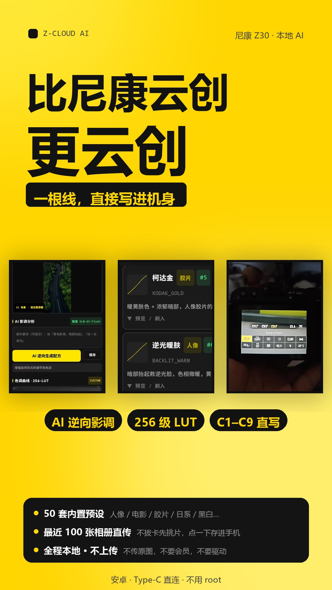
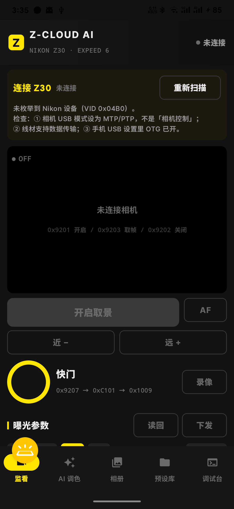
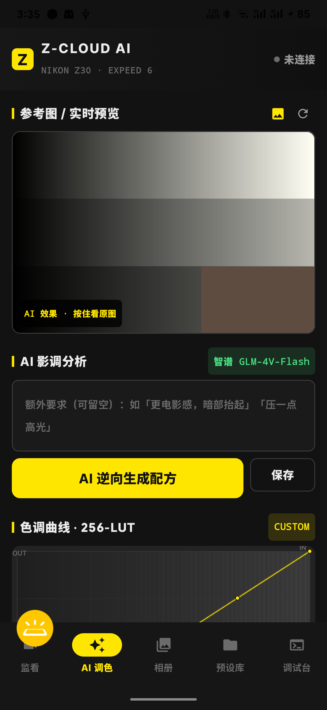
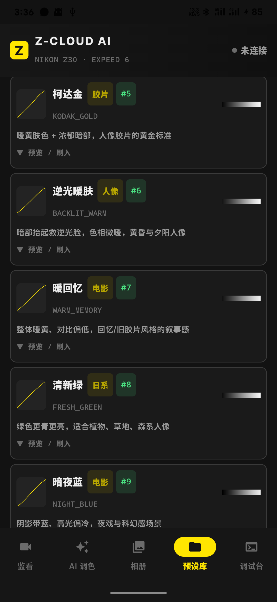
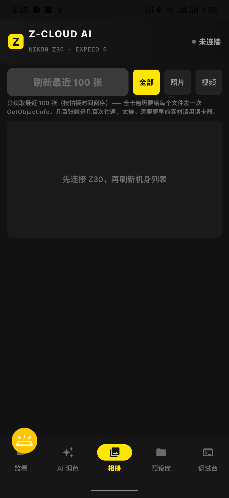
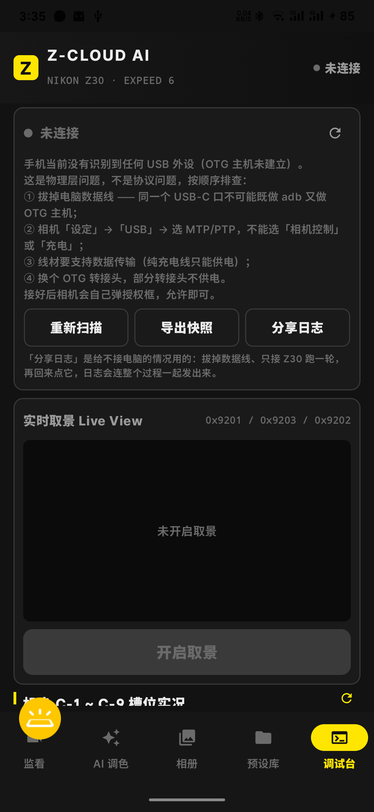
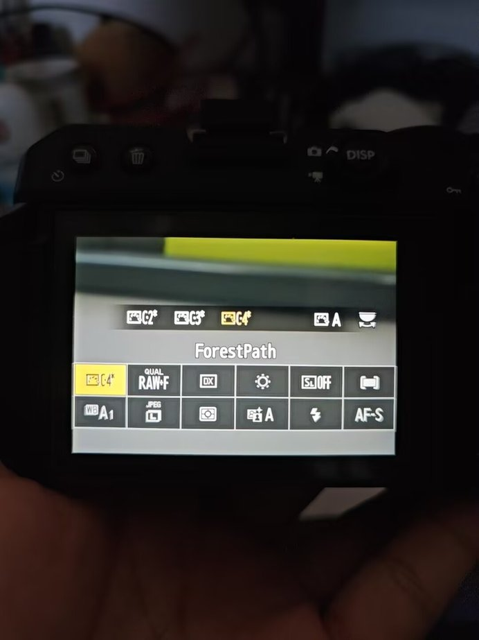

# Z-Cloud AI

**尼康 Z30 本地 AI 影调伴侣** — 一根 Type-C 线，把 AI 逆向出来的影调直接写进机身 C1–C9。

不用拔卡、不用读卡器、不用装桌面软件、不用上传参考图。

<p align="center">
  
</p>

---

## 这是什么

尼康官方有个「尼康云创」（Nikon Imaging Cloud）：把配方上传到云端，相机连 Wi-Fi 下载。流程长、要账号、要联网。

这个项目走另一条路：**手机 USB-OTG 直连相机，用 PTP 私有指令把优化校准直接写进机身**。

```
参考图 → 本地算直方图特征 → Vision LLM 逆向出曲线与参数 → 单调三次样条生成 256 级 LUT
      → 打包成 614 字节优化校准载荷 → 0x90CD 写进机身槽位 → 相机 LCD 当场生效
```

全程本地。参考图不离开手机，只有压缩后的缩略图和统计特征会发给大模型。

## 功能

| 模块 | 做什么 |
|---|---|
| **监看** | 实时取景（`0x9201`/`0x9203`/`0x9202`）、快门（`0x9207`）、自动对焦、手动推焦、光圈/快门/ISO/EV 读回与下发、拍完直接看大图 |
| **AI 调色** | 参考图 → 影调分析 → 曲线 + 参数 → 256 级 LUT 实时预览 → 一键刷入机身 |
| **相册** | 从机身读最近 100 张缩略图、按照片/视频筛、单张下载到手机相册、删除 |
| **预设库** | **200 套内置优化校准**（10 类分类 + 热度排序 + 灰阶预览带）、导入 `.NCP`、配方快传码 |
| **设置** | 相册张数 / 取景帧率 / 默认槽位 / 写入备份与回读校验 / 日志开关；USB 调试台收在「高级」里 |

## 界面

| 监看 | AI 调色 |
|---|---|
|  |  |

| 预设库（200 套） | 相册 |
|---|---|
|  |  |

| USB 调试台 | 写进机身之后，相机 LCD 就是这个味道 |
|---|---|
|  |  |


## 内置 200 套预设

176 套来自 [nikonpc.com](https://nikonpc.com/) 的真实 `.NCP` 配方（Fuji Provia / Velvia / Astia、Kodak Portra NC / Ektachrome / Kodachrome、Agfa、BeatLog、Flaat、SHING 系列等），
24 套由真实曲线做参数变体派生（美食 / 夜景两类，带「派生」标签）。

10 个分类：人像 / 电影 / 胶片 / 日系 / 黑白 / 风光 / 街拍 / 暗调 / 美食 / 夜景，每类至少 12 套。

## 技术要点

### PTP 私有指令

正确的一组（**网上流传的 `0x90C0`/`0x90C1`/`0x90C2` 是错的**，那三个是 InitiateCaptureRecInSdram / AfDrive / ChangeCameraMode）：

| OpCode | 名称 | 参数 | 数据 |
|---|---|---|---|
| `0x90CC` | GetPictCtrlData | 2 个 `(slot, 0)` | Data-In |
| `0x90CD` | SetPictCtrlData | 2 个 `(slot, 0)` | Data-Out |
| `0x90CE` | DelCstPicCtrl | 1 个 | — |
| `0x90CF` | GetPicCtrlCapability | 1 个 | Data-In |
| `0x9201`/`0x9203`/`0x9202` | Start / Get / End LiveView | — | — |
| `0x9207` | CaptureToSdram | `{0xFFFFFFFF, 1}` | — |
| `0x90C7` | GetEvent | — | Data-In |
| `0x90C8` | DeviceReady | — | — |

依据：libgphoto2 `ptp.h:575-660` + digiCamControl `ExecuteReadDataEx(0x90CC, slotnum, 0)`。

### 槽位号是 0x00C9–0x00D1，不是 0x00CB–0x00D3

真机上 `0x90CF` 能力查询给出的有效区间恰好是 9 个：

```
0x00C9 → 支持（有数据）    0x00CE → 支持（全零）
0x00CA → 支持（有数据）    0x00CF → 支持（全零）
0x00CB → 支持（全零）      0x00D0 → 支持（全零）
0x00CC → 支持（全零）      0x00D1 → 支持（全零）
0x00CD → 支持（全零）      0x00D2 → InvalidParameter
```

### 614 字节载荷格式（实测逆向）

固件逆向里那个 84 字节结构是 SDS 内部格式，**不是 PTP 线上格式**。从真机 `0x90CC` 读回的
两个真实配方（`Fuji Provia` / `Fuji Astia`）比对出来的线上格式是 **614 字节**：

| 偏移 | 长度 | 内容 |
|---|---|---|
| `+0x000` | 2 | 版本 `02 00` |
| `+0x002` | 20 | ASCII 名称（NUL 补齐） |
| `+0x019` | 1 | 点位数据字节数 `0x08` |
| `+0x02C` | 1 | 族/序号标记 |
| `+0x02F` | 8 | 4 组 `(x, y)` 控制点 |
| `+0x066` | **512** | **256 × u16 大端 LUT，值域 0..32767** |

`0x66 + 512 = 0x266 = 614`，恰好到底。LUT 是成像真值，控制点只是给机身 LCD 画图用的近似点。

写入时以 `recipe.lut` 为准，只在曲线真的变了的时候才覆盖 LUT 段 —— 机身存 15 位、内部算 8 位，
每次重推等于把用户曲线重新量化一次。

### USB 握手

相机连不上通常不是协议问题，是这几件事：

1. **PTP Class Reset**：`controlTransfer(0x21, 0x66, 0, ifaceId, null, 0, 2000)` — 不发这一步，会话起不来
2. **清端点 HALT**：两个 Bulk 端点各来一次 `CLEAR_FEATURE(ENDPOINT_HALT)`
3. **OpenSession 事务号必须是 0**（ISO 15740 要求），其它操作才自增
4. **失败重试 3 轮**，每轮重新枚举设备（旧 `UsbDevice` 实例 `openDevice` 会直接返 null）
5. **异步 UsbRequest 优先 + 同步粘性降级**：异步在某些主机控制器上「提交成功但没真正发出」，一旦降级就粘住
6. **一次读大块**：请求长度刚好等于 12 字节时设备会以短包结束并丢 body，表现是「头读到了 body 永远超时」

### 单调三次样条（Fritsch–Carlson）

曲线插值不能有过冲，否则暗部会出现反转的「鬼影」。用 Fritsch–Carlson 单调保形插值：
内点导数异号时切线置零，端点做 limiting，最后 Hermite 求值。输出 256 级 `UInt8` LUT。

### AI 调色

本地先用 Rec.709 亮度算直方图（黑位、高光截点、中灰偏移、平均饱和度、冷暖/绿品倾向），
再连同压缩到 384px / q62 的 JPEG 一起发给 Vision LLM，要求返回严格 JSON：

```json
{
  "preset_name": "AI_Cinematic_01",
  "base_profile": "Neutral",
  "sharpening": 2.0, "clarity": 1.0, "contrast": 0.0,
  "brightness": 0.0, "saturation": -1.0, "hue": 0.0,
  "use_custom_curve": true,
  "tone_curve_points": [{"x":0,"y":18},{"x":64,"y":52},{"x":128,"y":130},{"x":192,"y":205},{"x":240,"y":242}],
  "style_analysis": "暗部轻微抬起制造胶片灰雾感，压低高光溢出，整体微降饱和度。"
}
```

支持三家 OpenAI 兼容供应商：

| 供应商 | 模型 | 视觉 | 说明 |
|---|---|---|---|
| 智谱 | `glm-4v-flash` | ✅ | 免费额度够跑很多次 |
| DeepSeek | `deepseek-chat` | ❌ | 纯文本，靠本地特征 |
| 小米 MiMo | `mimo-vl-7b-rl` | ✅ | — |

## 构建

需要 JDK 17+、Android SDK 34。

```bash
git clone https://github.com/<you>/z-cloud-ai.git
cd z-cloud-ai
echo "sdk.dir=/path/to/Android/Sdk" > local.properties
./gradlew :app:assembleRelease
```

**签名**：仓库里没有 `.jks`。自己打包时在根目录建 `keystore.properties`：

```properties
storeFile=keystore/your.jks
storePassword=****
keyAlias=****
keyPassword=****
```

没有这个文件时 release 会退回未签名，装不上。用 `keytool -genkeypair` 自己生成一个。

## 安装到手机

```bash
# 魅族/部分国产 ROM 必须带 --user 0，否则 INSTALL_FAILED_USER_RESTRICTED
adb install --user 0 -r app-release.apk
```

## 用起来

1. 相机「设定 → USB」选 **MTP/PTP**（不能选「相机控制」或「充电」）
2. 线要支持数据传输，纯充电线只能供电
3. **同一个 USB-C 口不可能既做 adb 又做 OTG 主机** —— 调试完把电脑线拔掉，只接相机
4. 插上后相机会自己弹授权框，点「允许」
5. 调试台（设置 → 高级）能看到握手日志；连不上先看那里

## 已知限制

- `0x500E`（曝光程序）、`0x500D`/`0xD100`（快门）在 Z30 上是**只读属性**（`0x1014` 描述符实测），
  档位和快门只能物理转盘，App 只做显示
- `0x9207` 拍摄链路在 Z30 上还没有稳定复现的成功样本；`0x90C7` 事件流格式按 libgphoto2 +
  ZENCHE 两份实现写的，真机若拿不到 `0xC101` 事件会回退「从机身取最新」
- `0x90C5`/`0x90C6`（CurveDownload/Upload）在 Z30 上返回 `OperationNotSupported`
- `0xD201`（ChangePicCtrlItem）在 Z30 上返回 `DevicePropNotSupported`
- 只在 **Z30（VID 0x04B0 / PID 0x0452）** 上验证过。EXPEED 6 同代机型可能通用，未测

## 目录

```
app/src/main/java/com/zcloud/ai/
├── ptp/                 USB Host + PTP 容器 + 尼康私有指令
│   ├── NikonPtpDriver.kt   握手、重试、事务、实时取景、拍摄、存储、写入矩阵
│   ├── Ptp.kt              OpCode / 响应码 / 属性号 常量
│   ├── PtpContainer.kt     12 字节 PTP 头拆装（小端）
│   └── HexLog.kt           环形缓冲 + 落盘 + HexDump
├── core/                协议载荷与算法
│   ├── PcPayload614.kt     614 字节优化校准载荷解析/构建
│   ├── CubicSplineLut.kt   Fritsch–Carlson 单调三次样条 → 256 LUT
│   ├── NcpParserAndBuilder.kt  .NCP 导入导出（兼容旧 84 字节格式）
│   ├── BuiltInPresets.kt   200 套内置预设
│   ├── CameraStorage.kt    PTP 存储/对象信息解析
│   ├── RecipeShareCode.kt  配方快传码（Base64 文本）
│   └── ImagePipeline.kt    LUT + 参数 CPU 渲染预览
├── ai/                  AI 调色
│   ├── AiColorGradingRepository.kt  System Prompt + OpenAI 兼容调用 + 严格 JSON 解析
│   ├── ImageFeatureExtractor.kt     直方图特征 + 缩略图压缩
│   └── LlmProvider.kt               供应商配置与用量记账
├── data/                DataStore 持久化（设置、预设、API Key）
├── ui/                  Jetpack Compose（5 个 Screen + 曲线编辑器）
└── util/                图片加载
```

约 13,800 行 Kotlin。

## 致谢

- [libgphoto2](https://github.com/gphoto/libgphoto2) — `ptp.h` 里的尼康 OpCode 定义是唯一权威来源
- [digiCamControl](https://github.com/dukus/digiCamControl) — `0x90CC` 的两参数调用约定与字段布局
- [ZENCHE / 帧澈](https://github.com/Tauber01/ZENCHE) — USB 握手、重试与降级策略的参考实现
- [nikonpc.com](https://nikonpc.com/) — 176 套真实 `.NCP` 配方数据

## 许可

MIT，见 [LICENSE](LICENSE)。

**风险自负**：这是通过逆向得到的私有协议实现，写机身有风险。写入前 App 会先读回原样模板做备份，
但仍建议先在 C9（最后一个槽位）试。作者不对相机变砖、数据丢失负责。
